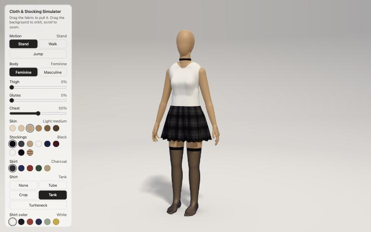
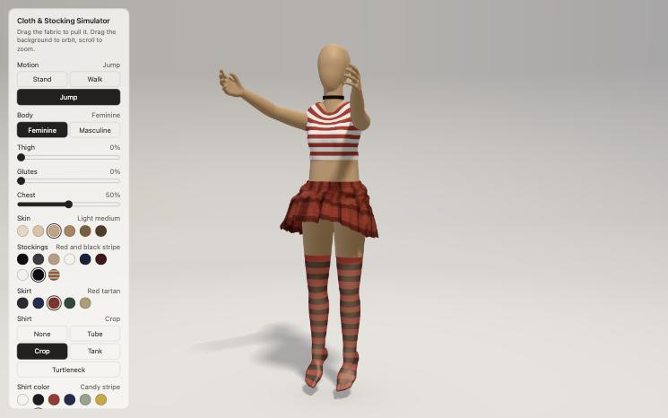
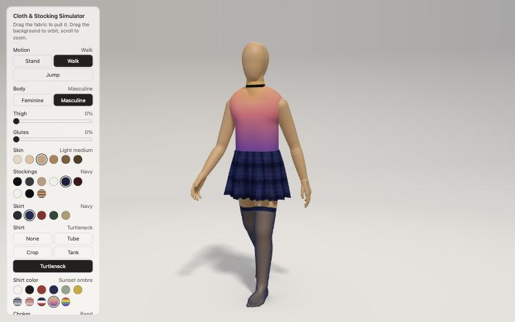

# Browser physics clothing

A cloth simulator that runs in the browser. A mannequin wears stockings, a pleated skirt, a shirt, and a choker. You can pull the fabric with the mouse, change the body and the clothes, and make the figure walk or jump.

Everything runs on the CPU in plain JavaScript. three.js draws the result.



| Jump | Walk |
|---|---|
|  |  |

## Run it

You need Node.js 20 or later.

```bash
npm install
```

```bash
npm run dev
```

Open the URL that Vite prints, normally `http://localhost:5173/`.

## Use it

- Drag the fabric to pull it. Release it and it snaps back.
- Drag the background to orbit. Scroll to zoom.
- **Motion** switches between Stand, Walk, and Jump.
- **Body** switches between the feminine and the masculine mannequin.
- **Thigh**, **Glutes**, and **Chest** reshape the body. The body rebuilds when you release the slider. **Chest** appears on the feminine body only.
- The swatches set the skin tone and the colour of each garment.
- **Shirt** and **Choker** pick a style or remove the garment.
- **Stretch**, **Snap-back**, **Grab radius**, and **Sheerness** tune the fabric.
- **Reset** puts the cloth back in its rest shape.

## Commands

| Command | What it does |
|---|---|
| `npm run dev` | Starts the dev server. |
| `npm run build` | Builds the static site into `dist/`. |
| `npm test` | Runs the headless simulation test in Node. It takes about 3 minutes. |
| `node scripts/bust-render.mjs <outDir> 0,0.5,1` | Renders the torso skin to PNG files without a browser. Add `--wire`, `--jump`, or `--walk`. |
| `node scripts/foot-render.mjs <outDir>` | Renders both bodies' feet to PNG files, bare and in the settled stocking: six views at rest, the walk's push-off and tiptoe. It prints how many skin pixels show through the stocking and paints them magenta. Add `--wire`. |

## How it works

The body is a set of tapered capsules. That one capsule model produces three things: the skin mesh, the rest shape of each garment, and the colliders the cloth pushes against. Because all three come from the same source, the cloth cannot disagree with the surface it sits on.

The cloth is a position-based solver. Each garment is a grid of points joined by stretch, shear, and bend constraints. Each frame, the solver moves the points, satisfies the constraints, and pushes points out of the capsules.

A pose is a set of joint angles. One deformation field in `src/pose.js` moves the capsules, the skin, and the garment rest shapes together. The chest bounce is one more term of that same field: a damped spring that follows how the chest accelerates.

## File map

| File | Role |
|---|---|
| `index.html` | The page, the control panel, and the styles. |
| `src/main.js` | The three.js scene, the UI wiring, and the frame loop. The only file that needs a browser. |
| `src/presets.js` | All data: body shapes, colours, garment styles, motions, and tuning values. |
| `src/body.js` | Builds the capsule body, the skin meshes, and the garment rest shapes. |
| `src/cloth.js` | The cloth solver and the capsule collision. |
| `src/garments.js` | Builds the stockings, the skirt, and the shirts. |
| `src/pose.js` | The deformation field for poses and the chest bounce spring. |
| `src/motion.js` | The walk and jump cycles and the state machine that blends between them. |
| `src/nylon.js` | The sheer stocking shader. |
| `src/colourway.js` | Solid, striped, block, and ombre colour patterns. |
| `test/sim.test.mjs` | The headless test. It asserts measured clearances, shapes, and timings. |
| `scripts/bust-render.mjs` | A software renderer for checking the skin without a browser. |
| `scripts/foot-render.mjs` | The same renderer pointed at the feet. |

## Notes for AI agents

Read this section before you change code.

**Units and axes.** Metres. `y` is up. The toes point along `+z`. Poses use radians.

**The rule that must hold.** Skin, garment rest shapes, and colliders all come from the capsule model in `BODIES` (`src/presets.js`), expanded in `src/body.js`. Do not build any of the three from a second source. Do not move one of them without moving the others through the field in `src/pose.js`.

**Where values go.** Put every tuning number in `src/presets.js`. The other files hold logic.

**What runs where.** Every file in `src/` except `main.js`, `nylon.js`, and `colourway.js` is plain typed-array code with no rendering imports. The test runs that code in Node.

**Verify a change.**

1. Run `npm test`. The last line must be `ok`.
2. The test prints each measured value beside its limit. Compare the values with the previous run. Several margins are small.
3. The test has two timing limits: a frame median under 12 ms and a total under 170 s. A busy machine can fail them. Rerun on a quiet machine before you conclude that the code is slower.
4. For a change you can see, check the page as well. A passing test does not prove that the picture is right.

**Drive the page from the console.** `window.__sim` exposes these members:

| Member | Use |
|---|---|
| `apply(option, id)` | Sets an option. Examples: `apply('motion', 'walk')`, `apply('body', 'masculine')`, `apply('shirt', 'tank')`. |
| `step(frames)` | Advances the simulation by fixed 1/60 s steps and renders. Use it when the tab is throttled. |
| `pose(partial)` | Holds a static pose. Keys: `hipL`, `hipR`, `kneeL`, `kneeR`, `ankleL`, `ankleR`, `toeL`, `toeR`, `shoulderL`, `shoulderR`, `elbowL`, `elbowR`, and `root: { y, z, pitch }`. A positive `toeL` or `toeR` bends the toes up. |
| `cloths` | The live cloth objects. Each has `pos`, `kind`, and `asleep`. |
| `motion` | A copy of the motion state: `state`, `id`, `t`, and `amp`. |
| `settings` | The current option values. |
| `camera`, `controls` | The three.js camera and the orbit controls. |
| `renderer`, `scene` | The three.js renderer and scene. |
| `grabAt(clothIndex, vertex)`, `dragTo(x, y, z)`, `release()` | Pull a cloth vertex from a script. |

The sliders rebuild the body on the `change` event, not on `input`. To set one from a script, set its `value` and dispatch both events.

**Known limits.**

- The cloths do not collide with each other.
- The shirts have no sleeves.
- A pose moves the body in the `y`-`z` plane only: up and down, and front to back. A pose moves nothing along `x`.

## Licence

MIT. See [LICENSE](LICENSE).
